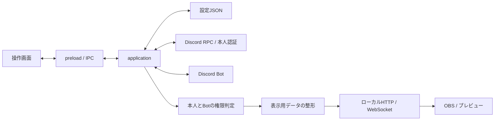

# 開発ガイド

## 構成と責務

```text
src/
├─ main/
│  ├─ index.js                  Electron起動と終了、ウィンドウの作成
│  ├─ application.js            設定・本人認証・配信を連携させるアプリ処理
│  ├─ paths.js                  開発時・exe内のパス解決
│  ├─ ipc-handlers.js           preloadからの要求とアプリ処理の接続
│  ├─ logging.js               メインプロセスのログ出力
│  ├─ config/
│  │  └─ store.js              設定初期値とJSONの読み書き
│  ├─ discord/
│  │  ├─ access-control.js     本人とBotの権限判定・有効期限管理
│  │  ├─ bot-client.js         Bot起動とDiscordイベントの登録
│  │  ├─ rpc-connection.js     RPC認可・本人確認・再接続・発言イベント購読
│  │  └─ ipc-transport.js      Discordの名前付きパイプ通信とフレーム処理
│  └─ overlay/
│     ├─ server.js            公開資産のHTTP配信とWebSocket送信
│     ├─ presentation.js      表示可能な設定・VC情報・メッセージの整形
│     └─ sorting.js           チャンネルとメンバーの並び順
├─ preload/
│  └─ index.js                 操作画面に公開するIPC API
└─ renderer/
   ├─ controller/
   │  ├─ index.html            操作画面の構造
   │  ├─ styles.css            操作画面のスタイル
   │  └─ controller.js         入力、設定復元、プレビュー操作
   └─ overlay/
      ├─ index.html            OBS画面の構造
      ├─ styles.css            OBS画面のスタイルとアニメーション
      └─ overlay.js            配信データの描画と編集操作

scripts/run-electron.js         開発・画面テスト用Electronランチャー
test/unit/                     単体テスト
test/integration/              アプリ処理とHTTP配信の結合テスト
test/support/                  Discordテストデータ
test/smoke/renderer.cjs         非表示Electronによる画面テスト
```

`src/main/index.js` が `package.json` の起動エントリです。ここで設定ストア、アプリ処理、IPC、ウィンドウを組み合わせます。`application.js` はElectron自体に依存せず、設定ストア・通信・画面への通知を引数で受け取ります。結合テストはこの公開APIを呼び出し、実ソースを文字列として書き換える方法には依存しません。

## データの流れ



本人IDはRPCの認証成功応答から取得し、保存済み設定や画面からの入力を本人確認には使いません。一覧取得だけでなく、履歴取得・新着メッセージ・状態配信・設定保存にも権限判定を適用します。非同期処理中に権限や設定が変わった場合は、古い取得結果を送信しません。

## 設定とパス

`.env` はプロジェクト直下に置きます。項目は [.env.example](../.env.example) に記載しています。開発時もexe実行時も、`app.getAppPath()` を基準に `.env` とアプリ資産を解決します。起動時のカレントフォルダーには依存しません。

利用者の設定は従来どおり `app.getPath('userData')/user_config.json` へ保存します。ファイル形式とアプリ名は変えていないため、フォルダー分割のための設定移行は不要です。保存済みの値が `.env` に由来する初期値を上書きします。OAuthトークンは暗号化した rpc-auth.bin に保存して再接続時に使用します。本人IDは保存値だけでは確定せず、その接続のAUTHENTICATE成功応答で確認します。

設定は同じフォルダーの一時ファイルへ書き込み、ディスクへの同期後に置き換えます。既存の正常な設定は `user_config.json.bak` に1世代保存し、本体が破損・欠落している場合はバックアップを読み込みます。破損した本体でバックアップを上書きしません。保存に失敗した場合は内部設定と配信表示を維持し、書き込み失敗を権限確認の失敗と区別して通知します。

## 画面・配信資産の変更

操作画面は `file:` で読み込み、同じフォルダーのCSS・JavaScriptを相対参照します。HTML内の既存イベントハンドラーから呼ぶ関数は、`controller.js` の通常スクリプトとして公開されます。

OBS画面は `127.0.0.1:8080` のローカルHTTPサーバーで配信します。

HTTPとWebSocketのHostは、待ち受けポートを持つ `localhost`・`127.0.0.1`・`[::1]` に限定します。WebSocketはさらにループバック接続と同ポートのローカルHTTP Originを要求し、Originなし・`null`・外部サイトからの接続をハンドシェイク時に拒否します。操作画面内のプレビューもHTTPで読み込むため、既存のOBS用URLはそのまま使えます。

| URL | 配信ファイル |
| --- | --- |
| `/overlay`、`/overlay.html` | `src/renderer/overlay/index.html` |
| `/overlay/styles.css` | `src/renderer/overlay/styles.css` |
| `/overlay/overlay.js` | `src/renderer/overlay/overlay.js` |

`?mode=editor` を付けると既存の編集モードになります。枠のハンドルは通常ドラッグで幅・高さを変更し、Shiftを押しながらドラッグすると0.2～3.0倍の範囲で縦横比を保って拡大・縮小します。結果は `postMessage` で操作画面の座標・サイズ・拡大率へ同期します。公開対象は `server.js` の許可リストで指定しています。OBS画面へ資産を追加した場合は、HTMLの参照と許可リスト、HTTP配信テストを一緒に更新してください。任意のプロジェクトファイルを返す汎用静的配信にはしないでください。

## テストとビルド

文字コードと不正なフォルダー名は次のコマンドで確認できます。Git管理中のテキスト、プロジェクト内のパス、実際の`app.log`をUTF-8として検証します。

```powershell
npm.cmd run test:encoding
```

開発・ビルド操作はプロジェクト直下で実行します。

```bat
npm ci --include=dev
npm test
npm run test:renderer
npm run dist:win
npm run test:packaged
```

`build.cmd` は上記を順に実行し、エラーがあれば停止します。`--no-pause` を付けると終了時のキー入力待ちを省略します。個別コマンドの用途は [README](../readme.md) の表も参照してください。

`test:renderer` は開発中のファイルを、`test:packaged` は `dist/win-unpacked/resources/app.asar` 内のファイルを使用します。どちらも操作画面とOBS画面を非表示で起動し、分離したCSS/JavaScript、保存済み選択の復元、権限解除時の消去を確認します。ローカル配信はテスト専用の空きポートを使い、実際のDiscordや起動中の8080番ポートには接続しません。

開発用シェルが `ELECTRON_RUN_AS_NODE` を設定している場合でも、`scripts/run-electron.js` が子プロセスのフラグを外してElectronを起動します。環境全体の設定は変更しません。

Electron Builderの同梱対象は `package.json` の `build.files` にある `src/main`・`src/preload`・`src/renderer` と `package.json`・`.env` です。実行時依存ライブラリはBuilderが同梱します。テスト・説明書・開発用スクリプトは含めません。新しい実行用ディレクトリを追加した場合は、この設定も確認してください。

自動テストは実アカウント接続を代替しません。配布前に、閲覧権限が異なるアカウント、Discord切断、ロール変更、OBSブラウザソースで確認してください。

## パッチ更新

既存のexeを対象に、更新用exeによるオフラインの差分更新ができます。生成コマンドは `build-patch.cmd` です。利用方法、バックアップからの復旧、次回配布の手順は [パッチ更新ガイド](PATCHING.md) を参照してください。

認証キャッシュは `src/main/config/auth-store.js`、再認証フローのテストは `test/unit/rpc-auth.test.js` にあります。`node scripts/run-electron.js test/smoke/auth-store.cjs` はWindows上で暗号化保存・読み直し・トークン更新・破損時の処理を検証し、build.cmdでも実行します。

## GitHubへの配布

配布専用のPublicリポジトリは `kusaribito9310/obs_tool_distribute` です。`build.cmd` が成功した後に `publish-github.cmd` を実行すると、現在のバージョンのReleaseを作成し、`dist/latest/OBSTool.exe` と `dist/latest/OBSTool-update.exe` をアップロードします。同じバージョンで再実行した場合は、そのRelease内の同名ファイルを更新します。

GitHub CLIは不要です。WindowsのGit Credential ManagerでGitHubへログインしているか、開発環境だけに `GITHUB_TOKEN` を設定してください。トークンを `.env` へ入れないでください。`.env` は配布exeへ同梱されるためです。
